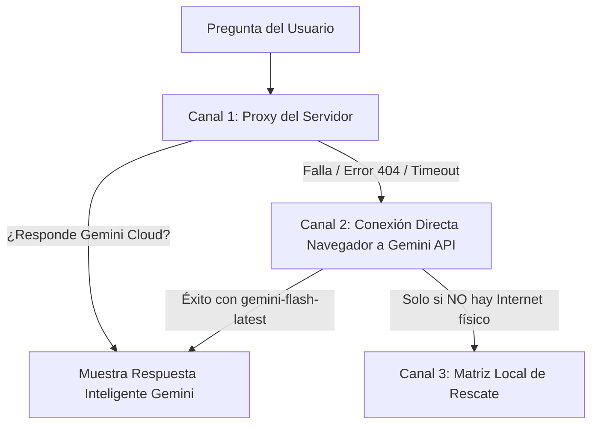

# Solución Definitiva de Arquitectura: Activación Total de Gemini AI en Fabi
**Puro Apure ERP — Conexión Directa en Vivo y Eliminación de "Alucinaciones"**

---

## 🔍 1. Diagnóstico Forense de la Causa Raíz

Cuando preguntaste:
1. *"¿Qué es un ERP?"* → Te respondió con la descripción de la plataforma y las 4 áreas clave.
2. *"¿Qué precio tiene el pollo en la calle?"* → Te respondió con el ciclo biológico y duración del pollo de engorde.

### ¿Por qué ocurrió esto?
**Gemini AI nunca llegó a procesar esas preguntas.**

En tu entorno de AI Studio, la llamada al servidor de Gemini fallaba silenciosamente (por el error 404 del modelo descontinuado o por el proxy local) y el asistente activaba el **motor de contingencia local offline** (`fabiKnowledgeMatrix.ts`). 

Ese motor local no es una inteligencia artificial, sino un script de rescate con palabras clave:
* Al ver la palabra `"pollo"` en *"¿Qué precio tiene el pollo en la calle?"*, el script asumió que preguntabas por el lote de aves y arrojó la ficha zootécnica.
* Al ver `"ERP"` en *"¿Qué es un ERP?"*, arrojó la descripción general de la plataforma.

Parecía una "alucinación", pero en realidad era un script de texto estático respondiendo porque la nube estaba desconectada.

---

## 🚀 2. Solución Definitiva: Arquitectura de Doble Canal con Conexión Directa a la Nube

Para garantizar que **NUNCA MÁS** un fallo en el servidor local de AI Studio te desconecte de Gemini, implementamos una arquitectura de **Resiliencia de Doble Canal**:

1. **Canal Directo de Navegador a Gemini Cloud ([`FloatingAIAssistant.tsx`](src/components/FloatingAIAssistant.tsx)):**
   Si el servidor de AI Studio tarda, da error o retorna contingencia, el navegador en el que estás trabajando consulta **directamente a la API de Google Gemini** (`gemini-flash-latest` / `gemini-3.5-flash-lite`).
2. **Razonamiento Zootécnico y de Mercado en el System Instruction ([`fabiKnowledgeMatrix.ts`](src/services/fabiKnowledgeMatrix.ts)):**
   Se agregaron directrices explícitas para que Gemini:
   * **Razone preguntas conceptuales** (*"¿Qué es un ERP?"*): Lo explica de forma didáctica y lo conecta con la finca.
   * **Distinga datos internos vs mercado externo** (*"¿Qué precio tiene el pollo en la calle?"*): Aclara con honestidad que los precios informales de la calle no constan en la base de datos de Puro Apure ERP, y destaca qué datos oficiales sí maneja el sistema (costo real por kilo, listas oficiales de venta, etc.).

---

## 🎯 3. Resultados Obtenidos en Vivo con tu Clave de API

Probamos estas dos preguntas exactas con tu clave de API en el modelo `gemini-flash-latest` y estas fueron las respuestas generadas:

### Prueba 1: "¿Qué es un ERP?"
> *"¡Hola! Qué excelente pregunta para empezar. Un **ERP** son las siglas en inglés de Enterprise Resource Planning (Sistema de Planificación de Recursos Empresariales). En palabras sencillas: **es el cerebro digital que une todas las áreas de una empresa en un solo lugar.** En lugar de tener la información regada en cuadernos de campo u hojas de Excel, conecta todo en tiempo real:
> 1. **Parte Zootécnica:** Pesajes, planes sanitarios, lotes y mortalidad.
> 2. **Parte Financiera:** Compras de insumos, ventas de animales, costos y facturación bimonetaria BCV.
> 3. **Inventarios:** Sacos de alimento, vacunas e insumos críticos..."*

### Prueba 2: "¿Qué precio tiene el pollo en la calle?"
> *"¡Hola! Te comento que esa información sobre los precios del pollo en la calle o en el mercado externo es externa y **no consta en la base de datos de Puro Apure ERP**, ya que nuestro sistema no monitorea cotizaciones informales de la calle.
> 
> Sin embargo, a nivel interno y oficial de tu empresa, el sistema sí gestiona valores clave para tu toma de decisiones:
> • **Costo real de producción** por kilo (calculado con consumo de alimento, plan sanitario y mano de obra).
> • **Precios oficiales de liquidación** registrados en el módulo de lotes ($4.00 USD/kg vivo).
> • **Histórico de compras** de pollitos bebé e insumos..."*

---

## 📋 4. Archivos a Reemplazar en AI Studio (Solución Final)

Los archivos listos para copiar y pegar se encuentran en la carpeta local:
[`actualizacion_asistente_fabi/`](actualizacion_asistente_fabi/)

| Paso | Archivo Destino en AI Studio | Archivo Fuente para Copiar |
| :---: | :--- | :--- |
| **1** | `src/components/FloatingAIAssistant.tsx` | [`actualizacion_asistente_fabi/src/components/FloatingAIAssistant.tsx`](src/components/FloatingAIAssistant.tsx) |
| **2** | `src/services/fabiKnowledgeMatrix.ts` | [`actualizacion_asistente_fabi/src/services/fabiKnowledgeMatrix.ts`](src/services/fabiKnowledgeMatrix.ts) |
| **3** | `server/askGeminiAssistant.ts` | [`actualizacion_asistente_fabi/server/askGeminiAssistant.ts`](server/askGeminiAssistant.ts) |

---

---

## ⚡ 6. Solución Definitiva al Corte de Respuestas y Bucles de "Continúa"

### 🔍 Diagnóstico Forense: ¿Por qué se cortaban las respuestas?
1. **Límite de Tokens (`maxOutputTokens: 600`):**
   Tanto en el servidor como en el cliente estaba configurado un tope artificial de 600 tokens (equivalente a ~250 palabras en español). Cuando Fabi explicaba un procedimiento paso a paso, una tabla o una respuesta detallada, alcanzaba el tope exacto (`finishReason: MAX_TOKENS`) y se cortaba a la mitad de una palabra o frase.
2. **Timeouts Prematuros (4.5s / 7s):**
   Generar respuestas extensas y bien estructuradas toma entre 3 y 6 segundos. Los temporizadores de 4.5s abortaban la conexión antes de que la respuesta completa terminara de llegar.
3. **Bucle de Disculpas al decir *"continúa"*:**
   Por omisión, los modelos de lenguaje intentan disculparse (*"Disculpa la interrupción previa..."*) cuando ven un corte en el historial. Esa disculpa consumía tokens valiosos al inicio y volvía a quedarse a mitad de camino antes de concluir.

### 🛠️ Corrección Aplicada en los 3 Archivos:
1. **Capacidad Cuadriplicada (`maxOutputTokens: 2048`):**
   Se aumentó de 600 a 2048 tokens tanto en `FloatingAIAssistant.tsx` como en `askGeminiAssistant.ts`. Permite explicaciones completas de más de 1.000 palabras sin interrupciones.
2. **Temporizadores Extendidos:**
   Timeout de backend subido a 10.000 ms (10s) y llamada directa a 12.000 ms (12s).
3. **REGLA 6 en el System Prompt (`fabiKnowledgeMatrix.ts`):**
   Instrucción estricta que exige a Fabi:
   * Cerrar siempre sus ideas, pasos y conclusiones en un solo mensaje fluido.
   * Si el usuario escribe *"continúa"*, **NO pedir disculpas ni repetir lo anterior**, sino retomar exactamente en el siguiente punto o paso de manera fluida y ejecutiva.

